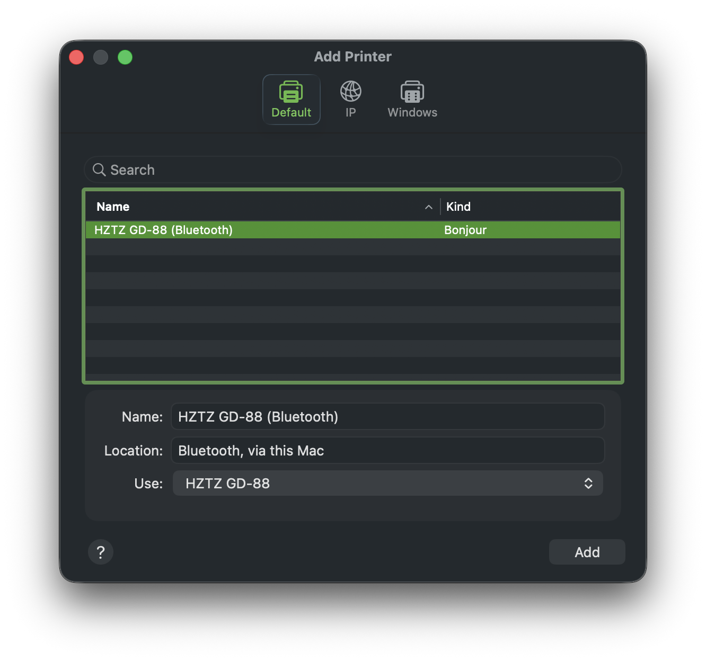
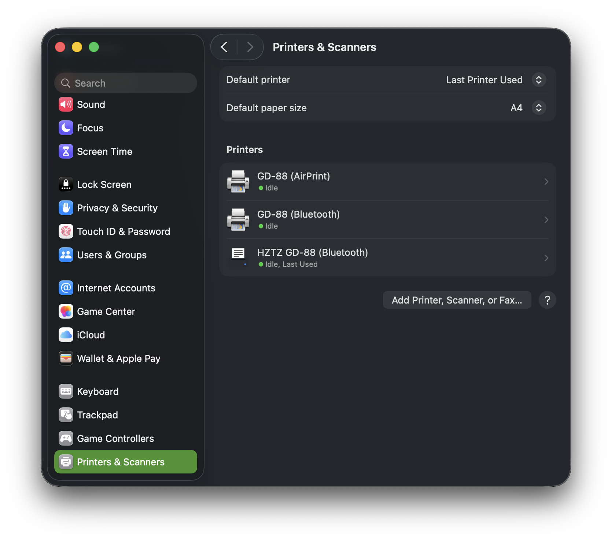

# gd88-bridge

Print to an **HZTZ GD-88** (also sold as **PeriPage A40** and **Munbyn ITP01**) A4 portable thermal
printer from **macOS over Bluetooth**. It shows up as a normal AirPrint printer, with no vendor driver,
no Rosetta and no cable.

> Unofficial project. It is not affiliated with HZTZ, PeriPage, Munbyn or the makers of the HyPrint app.



## Which printers

| Name you may know it by | Notes |
|---|---|
| **HZTZ GD-88** ("GD88"), "A4 portable thermal printer" | The phone app for it is **HyPrint** (iOS). |
| **PeriPage A40** | The GD-88's firmware reports itself as `PeriPage_A40`. |
| **Munbyn ITP01** | Munbyn's version of the PeriPage A40. |

**Tested:** GD-88, firmware V6.0.4, hardware 1.08, on macOS 26 (Apple Silicon). Other PeriPage A40
and A40+ printers will probably work too; please open an issue to report how it goes.

## What you get

- **A driverless printer** in System Settings › Printers & Scanners. It appears in *Add Printer* by
  itself (Kind: Bonjour).
- **Print from any app with ⌘P.** A4 by default, or any length from 20 mm to 1 m on the 210 mm roll.
- **Printer status in macOS.** "Lid open" or "Out of paper" shows in the print queue. The job waits
  and prints by itself once you fix the problem.
- **Battery level** under the queue's *Supply Levels*.
- **Less paper.** Blank space at the end of a print is trimmed, keeping 8 mm.
- **No vendor driver and no Rosetta.** The page-to-printer conversion is built in. For black-and-white
  pages its output is byte-for-byte identical to the vendor driver's.
- **Photos print in shades of gray,** using Floyd–Steinberg dithering. *Draft* quality gives crisp
  black and white.
- **Private.** The bridge listens on `127.0.0.1` only and announces itself to *this Mac* only; nothing
  is exposed to your network.
- **Your phone keeps working.** The bridge disconnects after every job, so the phone app can connect again.



## Install

You need:
- macOS 13 or newer
- Apple's Command Line Tools (`xcode-select --install`)
- the printer paired in **System Settings › Bluetooth** (it appears as `GD-88_XXXX`)

```sh
git clone https://github.com/pedrinho/gd88-bridge.git
cd gd88-bridge
./install.sh
```

1. When macOS asks **"GD88 Bridge" would like to use Bluetooth**, click **Allow**.
2. Open **System Settings › Printers & Scanners › Add Printer…**, select **HZTZ GD-88 (Bluetooth)** and
   click **Add**.

`install.sh` passes its arguments on to the bridge:

| Option | Use |
|---|---|
| `--printer 01-23-45-67-89-ab` | Pick the printer by Bluetooth address (if several are paired, or it isn't found by name). |
| `--raw-port 9100` | Turn on the raw port, for a queue that uses the vendor's own driver (off by default, see below). |
| `--no-bonjour` | Don't announce the printer; add it by hand with `lpadmin -p GD88 -E -v ipp://localhost:8631/ipp/print -m everywhere`. |

**Update:** `git pull && ./install.sh`. macOS asks for Bluetooth permission again after every build,
because each build has a new signature.
**Uninstall:** `./uninstall.sh`. Add `--purge` to also delete its settings and log.

## How it works

```
any app (⌘P) ─► CUPS ─ PWG or Apple raster ─► gd88bridge ─ ESC/POS ─► IOBluetooth (RFCOMM) ─► printer
                          IPP on 127.0.0.1:8631                   classic Bluetooth, channel 1
```

- **IPP server.** gd88bridge is a small IPP Everywhere / AirPrint server (the subset of PWG 5100.14 a
  single printer needs). It passes CUPS's `ipp-everywhere.test` conformance suite. Bonjour announces it
  on the local-only interface, as `gd88-bridge.local` → `127.0.0.1`.
- **Conversion.** It converts PWG raster, Apple Raster (URF) or JPEG into the printer's ESC/POS raster:
  `GS v 0`, 1680 dots per line, 203 dpi.
- **Bluetooth.** It talks to the printer over classic Bluetooth (Serial Port Profile on RFCOMM channel 1)
  through Apple's IOBluetooth framework. It does *not* use the `/dev/cu.GD-88_…` serial port, which can
  leave processes stuck in the kernel; see [docs/PROTOCOL.md](docs/PROTOCOL.md).
- **Status.** Before each job it reads the printer's status byte, and holds the job while the lid is
  open or the paper is out. It never connects while idle, so the printer stays free for your phone.
- **Raw port (optional, off by default).** With `--raw-port 9100` it also accepts jobs from a queue that
  uses the vendor's own GD-88 driver. That driver is Intel-only and needs Rosetta; you don't need it with
  gd88bridge. Only the commands that driver produces are let through.

## Status and the printer's light

| macOS print queue shows | Printer | Light |
|---|---|---|
| Idle / printing | ready | green (blue while the Mac is connected) |
| **Lid open** (`cover-open-error`) | lid open | red |
| **Out of paper** (`media-empty-error`) | lid closed, no paper | red |
| "Printer off or out of range" | can't connect; the job waits up to 30 min | — |
| Supply level "Battery" | battery %, estimated from voltage | — |

## Security

gd88bridge is a print server without passwords, so it's built to be reachable from this Mac only and
to be hard to misuse from there.

- **Not on your network.** It listens on `127.0.0.1` only, and the Bonjour announcement goes to this Mac
  only.
- **Web pages can't use it.** A page in your browser can try to reach `localhost`, for example through
  DNS rebinding. The IPP server only answers requests addressed to `localhost`, `127.0.0.1`, `[::1]` or
  `gd88-bridge.local`.
- **No printer commands from outside.**
  - On the IPP path, the bridge generates every byte it sends to the printer itself; documents only
    become raster image data.
  - The optional raw port accepts only the vendor driver's command set. Anything else is rejected
    before it reaches Bluetooth, including the documented maintenance and settings commands (see
    [docs/PROTOCOL.md](docs/PROTOCOL.md)).
  - Raw jobs are a common target of "cross-site printing" from web pages, which is why the port is off
    by default.
- **Limits:**
  - documents up to 128 MB (raw jobs 64 MB)
  - 50 jobs waiting at most
  - pages and photos up to about 1 m of paper
  - 32 connections, 100 header lines, 1 MB of IPP attributes, collections nested 16 deep
  - Identify-Printer at most once every 10 s
- **Your documents stay private.** Spooled jobs (`~/Library/Caches/GD88Bridge`) and the log are readable
  by your user only. Jobs are deleted after printing and when the bridge restarts.
- **What it doesn't protect against:** anything already running as *any* user on this Mac can print
  or cancel jobs. That's the same as any printer shared without a password.

Found a security problem? Please open an issue without exploit details, and I'll arrange a private way
to share them.

## Troubleshooting

- **See what it's doing.** The log is `~/Library/Logs/gd88-bridge.log`, and there's a status page at
  <http://localhost:8631/>.
- **"no paired GD-88/PeriPage printer".** Pair the printer in System Settings › Bluetooth first, or
  install with `--printer <address>`.
- **Bluetooth permission was denied.** Turn on *GD88 Bridge* in System Settings › Privacy & Security ›
  Bluetooth, or run `tccutil reset Bluetooth local.gd88-bridge` and `./install.sh` again.
- **Printer off or out of range.** The job waits and prints when the printer is back, for up to 30
  minutes.
- **The phone app is connected.** The printer accepts one connection at a time. Close the app's
  connection while printing from the Mac.
- **More detail.** Stop the service with `launchctl bootout gui/$(id -u)/local.gd88-bridge`, then run
  `GD88_DEBUG=1 ~/Library/Application\ Support/GD88Bridge/GD88Bridge.app/Contents/MacOS/gd88bridge` in a
  terminal to log every byte. Run `./install.sh` afterwards to start the service again.

## Development

- `tools/test.sh` builds the bridge and runs every check that doesn't print:
  - unit tests (`tests/`) for the IPP reader and writer, HTTP handling (Host check, lengths, chunked
    bodies), raster decoding, the printer-data encoder, the raw-port filter, status mapping, the job
    queue, and whole IPP requests. They're built with `swiftc`, so no Xcode is needed.
  - an offline self-test: raster decoding against macOS's own CUPS filters, trimming, and a byte-for-byte
    comparison with the vendor driver when it's installed
  - CUPS's IPP Everywhere conformance suite, against a `--dry-run` copy on a private port
- `gd88bridge --dry-run` writes the printer bytes to files instead of sending them over Bluetooth.
  `--encode IN OUT` and `--decode IN OUT` convert single files.
- `tools/mkstrip.py` makes a short 210 × 39 mm test PDF. Print it with
  `lp -d <queue> -o media=Custom.595x110 strip.pdf`.
- `tools/preview.py` turns printer bytes back into an image.
- What is known about the printer's protocol: [docs/PROTOCOL.md](docs/PROTOCOL.md).

## Credits

- [aaa4xu/peripage](https://github.com/aaa4xu/peripage): reverse-engineered PeriPage BLE protocol notes
  (status bits, battery, darkness, and the commands never to send).
- [bitrate16/peripage-python](https://github.com/bitrate16/peripage-python) and
  [eliasweingaertner/peripage-A6-bluetooth](https://github.com/eliasweingaertner/peripage-A6-bluetooth):
  PeriPage Bluetooth printing.
- [CUPS](https://github.com/OpenPrinting/cups) and the [PWG](https://www.pwg.org/) IPP Everywhere and
  PWG Raster specifications.

## License

MIT. See [LICENSE](LICENSE).
